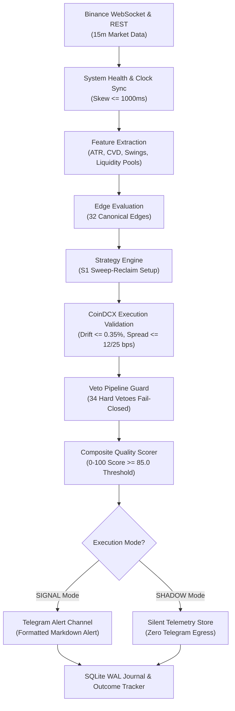

# NEO-WILDER V4 — প্রাতিষ্ঠানিক ক্রিপ্টো ফিউচার্স সিগন্যাল ইন্টেলিজেন্স ইঞ্জিন (বাংলা গাইড)
## Institutional-Grade, Signal-Only Crypto Futures Intelligence System

[](https://www.python.org/downloads/)
[]()
[]()
[]()
[]()

> **বিশেষ দ্রষ্টব্য (Mandatory Architecture Policy):**
> **NEO-WILDER V4 স্থায়ীভাবে একটি "SIGNAL_ONLY" সিস্টেম।** এই সফটওয়্যারটিতে কোনো স্বয়ংক্রিয় ট্রেড এক্সিকিউশন, এক্সচেঞ্জ ব্যালেন্স উইথড্রয়াল বা প্রাইভেট এপিআই কি (API Key) পরিচালনার কোনো কোড নেই এবং কখনোই যুক্ত করা হবে না। এটি শুধুমাত্র বায়ন্যান্সের পাবলিক মার্কেট ডেটা বিশ্লেষণ করে টেলিগ্রামের মাধ্যমে ভারতীয় ট্রেডারদের CoinDCX-এ ম্যানুয়ালি ট্রেড করার উপযোগী অ্যালার্ট পাঠায়।

---

## সূচিপত্র (Table of Contents)

- [অধ্যায় ১ — প্রকল্প পরিচিতি (Project Introduction)](#অধ্যায়-১--প্রকল্প-পরিচিতি-project-introduction)
- [অধ্যায় ২ — সম্পূর্ণ সিস্টেম ওভারভিউ (Complete System Overview)](#অধ্যায়-২--সম্পূর্ণ-সিস্টেম-ওভারভিউ-complete-system-overview)
- [অধ্যায় ৩ — সিগন্যাল কীভাবে তৈরি হয় (How a Signal Is Generated)](#অধ্যায়-৩--সিগন্যাল-কীভাবে-তৈরি-হয়-how-a-signal-is-generated)
- [অধ্যায় ৪ — স্ট্র্যাটেজিসমূহের বিস্তারিত ব্যাখ্যা (Strategies Explained)](#অধ্যায়-৪--স্ট্র্যাটেজিসমূহের-বিস্তারিত-ব্যাখ্যা-strategies-explained)
- [অধ্যায় ৫ — সকল ৩২টি এজের বিস্তারিত বিবরণ (All 32 Edges Explained)](#অধ্যায়-৫--সকল-৩২টি-এজের-বিস্তারিত-বিবরণ-all-32-edges-explained)
- [অধ্যায় ৬ — সকল ৪৯টি ভেটোর বিবরণ (All 49 Vetoes Explained)](#অধ্যায়-৬--সকল-৪৯টি-ভেটের-বিবরণ-all-49-vetoes-explained)
- [অধ্যায় ৭ — কোয়ালিটি স্কোরিং সিস্টেম (Quality Scoring System)](#অধ্যায়-৭--কোয়ালিটি-স্কোরিং-সিস্টেম-quality-scoring-system)
- [অধ্যায় ৮ — বায়ন্যান্স মার্কেট ডেটা কালেকশন (Binance Data Collection)](#অধ্যায়-৮--বায়ন্যান্স-মার্কেট-ডেটা-কালেকশন-binance-data-collection)
- [অধ্যায় ৯ — CoinDCX এক্সিকিউশন ভ্যালিডেশন (CoinDCX Validation)](#অধ্যায়-৯--coindcx-এক্সিকিউশন-ভ্যালিডেশন-coindcx-validation)
- [অধ্যায় ১০ — টেলিগ্রাম সিগন্যাল পাবলিকেশন (Telegram Alerts)](#অধ্যায়-১০--টেলিগ্রাম-সিগন্যাল-পাবলিকেশন-telegram-alerts)
- [অধ্যায় ১১ — সিগন্যাল ফরম্যাট ও কাল্পনিক উদাহরণ (Signal Format Explained)](#অধ্যায়-১১--সিগন্যাল-ফরম্যাট-ও-কাল্পনিক-উদাহরণ-signal-format-explained)
- [অধ্যায় ১২ — সম্পূর্ণ প্রজেক্ট ফাইল স্ট্রাকচার (Project File Structure)](#অধ্যায়-১২--সম্পূর্ণ-প্রজেক্ট-ফাইল-স্ট্রাকচার-project-file-structure)
- [অধ্যায় ১৩ — ওরাকল ক্লাউড VPS-এ ইনস্টলেশন গাইড (Installation on Oracle VPS)](#অধ্যায়-১৩--ওরাকল-ক্লাউড-vps-এ-ইনস্টলেশন-গাইড-installation-on-oracle-vps)
- [অধ্যায় ১৪ — কনফিগারেশন গাইড (Configuration Guide)](#অধ্যায়-১৪--কনফিগারেশন-গাইড-configuration-guide)
- [অধ্যায় ১৫ — বট চালানো ও পরিচালনা (Running & Managing the Bot)](#অধ্যায়-১৫--বট-চালানো-ও-পরিচালনা-running--managing-the-bot)
- [অধ্যায় ১৬ — শ্যাডো মোড বনাম সিগন্যাল মোড (Shadow Mode vs Signal Mode)](#অধ্যায়-১৬--শ্যাডো-মোড-বনাম-সিগন্যাল-মোড-shadow-mode-vs-signal-mode)
- [অধ্যায় ১৭ — ডাটাবেস ও জার্নালিং (Database & Journal)](#অধ্যায়-১৭--ডাটাবেস-ও-জার্নালিং-database--journal)
- [অধ্যায় ১৮ — টেস্টিং ও ব্যাকটেস্টিং ফ্রেমওয়ার্ক (Testing & Backtesting)](#অধ্যায়-১৮--টেস্টিং-ও-ব্যাকটেস্টিং-ফ্রেমওয়ার্ক-testing--backtesting)
- [অধ্যায় ১৯ — সমস্যা সমাধান ও ট্রাবলশুটিং (Troubleshooting & Real Bugs)](#অধ্যায়-১৯--সমস্যা-সমাধান-ও-ট্রাবলশুটিং-troubleshooting--real-bugs)
- [অধ্যায় ২০ — স্ট্র্যাটেজি ও এজ রোডম্যাপ (Development Roadmap)](#অধ্যায়-২০--স্ট্র্যাটেজি-ও-এজ-রোডম্যাপ-development-roadmap)
- [অধ্যায় ২১ — ঝুঁকি ও সীমাবদ্ধতা (Risks & Limitations)](#অধ্যায়-২১--ঝুঁকি-ও-সীমাবদ্ধতা-risks--limitations)
- [অধ্যায় ২২ — শিক্ষানবিস অপারেটর চেকলিস্ট (Beginner Daily Checklist)](#অধ্যায়-২২--শিক্ষানবিস-অপারেটর-চেকলিস্ট-beginner-daily-checklist)
- [অধ্যায় ২৩ — সচরাচর জিজ্ঞাস্য প্রশ্নাবলী (FAQ)](#অধ্যায়-২৩--সচরাচর-জিজ্ঞাস্য-প্রশ্নাবলী-faq)
- [অধ্যায় ২৪ — প্রযুক্তিগত শব্দকোষ (Glossary)](#অধ্যায়-২৪--প্রযুক্তিগত-শব্দকোষ-glossary)

---

## অধ্যায় ১ — প্রকল্প পরিচিতি (Project Introduction)

### ১.১ NEO-WILDER V4 কী?
NEO-WILDER V4 হলো একটি পাইথন-ভিত্তিক কোয়ান্টিটেটিভ ট্রেডিং অ্যানালিটিক্স সিস্টেম। এটি ক্রিপ্টোকারেন্সি ফিউচার্স মার্কেটের বৈজ্ঞানিক এবং তথ্য-ভিত্তিক সুযোগগুলো স্বয়ংক্রিয়ভাবে পর্যবেক্ষণ করে।

### ১.২ এটি কোন সমস্যার সমাধান করে?
ক্রিপ্টো বাজারে সাধারণ ট্রেডাররা যেসব সাধারণ ভুলের কারণে মূলধন হারান (যেমন: অতিরিক্ত ট্রেড করা বা Over-trading, ভুল স্টপ লস নির্ধারণ, উচ্চ স্প্রেড ও ফি সম্পর্কে অসচেতনতা, এবং আবেগতাড়িত সিদ্ধান্ত), NEO-WILDER V4 সেই ঝুঁকিগুলো গাণিতিক নিয়মের মাধ্যমে দূর করে। ভারতীয় ব্যবহারকারীদের জন্য CoinDCX-এর উচ্চ ফি এবং স্প্রেডের পরও যাতে একটি ট্রেড লাভজনক (Positive EV) হতে পারে, তা নিশ্চিত করেই শুধুমাত্র সিগন্যাল প্রদান করে।

### ১.৩ সিস্টেমটি কী করে?
- বায়ন্যান্সের পাবলিক মার্কেট ডেটা (15m Candles, Trades, Orderbook Depth, Funding Rates) রিয়েল-টাইমে বিশ্লেষণ করে।
- ৩২টি গাণিতিক এজ (Edge) এবং ৪৯টি নিরাপত্তা ভেটো (Veto) প্রয়োগ করে সেটআপ যাচাই করে।
- CoinDCX-এর বর্তমান পাবলিক স্প্রেড ও লিকুইডিটি যাচাই করে নেট রিস্ক-রিওয়ার্ড রেশিও (Net R:R $\ge 1.50$) নিশ্চিত করে।
- সম্পূর্ণ প্রস্তুত সিগন্যালটি বিস্তারিত পরিকল্পনা ও স্টপ লসসহ টেলিগ্রামে পাঠায়।

### ১.৪ সিস্টেমটি কী করে না?
- **কখনোই কোনো এক্সচেঞ্জে নিজে থেকে বাই বা সেল অর্ডার বসায় না।**
- **ব্যবহারকারীর ফান্ডের কোনো অ্যাক্সেস রাখে না বা ব্যালেন্স স্পর্শ করে না।**
- কোনো গ্যারান্টিযুক্ত লাভের মিথ্যা দাবি করে না।

---

## অধ্যায় ২ — সম্পূর্ণ সিস্টেম ওভারভিউ (Complete System Overview)

সিস্টেমটি একক পাইথন প্রসেসের মাধ্যমে চলে এবং অত্যন্ত কম রিসোর্সে (১ জিবি র‍্যামের VPS) চলতে সক্ষম।



> বিস্তারিত আর্কিটেকচার পর্যালোচনার জন্য দেখুন: [`docs/ARCHITECTURE_BN.md`](file:///c:/projects/neo-wilder-v4/docs/ARCHITECTURE_BN.md)

---

## অধ্যায় ৩ — সিগন্যাল কীভাবে তৈরি হয় (How a Signal Is Generated)

একটি সিগন্যাল বায়ন্যান্সের ১৫-মিনিটের ক্যান্ডেল ক্লোজ হওয়ার পর নিচের সুনির্দিষ্ট পাইপলাইনের মাধ্যমে যাচাই হয়:
1. **ক্যান্ডেল সমাপ্তি:** বায়ন্যান্স থেকে একটি ১৫-মিনিটের বার সম্পন্ন হওয়ার বার্তা আসে।
2. **মার্কেট ফিচার হিসাব:** ক্যান্ডেলটির সাহায্যে ATR, সুইং হাই/লো, ইকুয়াল লো লিকুইডিটি পুল, এবং কিউমুলেটিভ ভলিউম ডেল্টা (CVD) গণনা করা হয়।
3. **S1 সেটআপ ফিল্টার:** মূল্য যদি পূর্ববর্তী লিকুইডিটি পুলের নিচে ফেক ব্রেকআউট (Sweep) করে আবার উপরে ক্লোজ হয়, তবে একটি প্রাথমিক ক্যান্ডিডেট তৈরি হয়।
4. **CoinDCX মূল্য যাচাই:** CoinDCX এপিআই থেকে রিয়েল-টাইম মূল্য ও স্প্রেড আনা হয়। মূল্যের ব্যবধান ০.৩৫% এর বেশি হলে সিগন্যাল বাদ দেওয়া হয়।
5. **ভেটো গেট:** ৩৪টি হার্ড ভেটোর কোনোটি সক্রিয় কিনা তা পরীক্ষা করা হয়। কোনো হার্ড ভেটো সক্রিয় থাকলে তাৎক্ষণিকভাবে সেটআপটি পরিত্যক্ত হয়।
6. **স্কোরিং:** সেটআপটিকে ১০০ নম্বরের স্কেলে স্কোর করা হয়। স্কোর ৮৫.০ এর উপরে হলে সিগন্যালটি অনুমোদিত হয়।
7. **টেলিগ্রাম বার্তা:** অনুমোদিত সিগন্যালটি টেলিগ্রামে পোস্ট হয় এবং ডাটাবেসে সেভ হয়।

> সম্পূর্ণ লাইফসাইকেলের জন্য দেখুন: [`docs/SIGNAL_LIFECYCLE_BN.md`](file:///c:/projects/neo-wilder-v4/docs/SIGNAL_LIFECYCLE_BN.md)

---

## অধ্যায় ৪ — স্ট্র্যাটেজিসমূহের বিস্তারিত ব্যাখ্যা (Strategies Explained)

সিস্টেমে কোডকৃত ৩টি স্ট্র্যাটেজির বাস্তব পরিসংখ্যান:
- **মোট ইমপ্লিমেন্টেড:** ৩টি
- **বর্তমানে সক্রিয় (ACTIVE):** ১টি (`S1_SWEEP_RECLAIM`)
- **শ্যাডো মোডে (SHADOW):** ১টি (`S2_OI_EXHAUSTION`)
- **নিষ্ক্রিয় (DISABLED):** ১টি (`S3_BASIS_DISLOCATION`)

### ৪.১ S1: লিকুইডিটি সুইপ ও রিক্লেইম (S1_SWEEP_RECLAIM — ACTIVE)
- **উদ্দেশ্য:** বাজারের মেজর সুইং লো বা লিকুইডিটি পুল থেকে রিটেইল ট্রেডারদের স্টপ লস হান্ট হওয়ার পর স্মার্ট মানির সাথে রিভার্সাল এন্ট্রি নেওয়া।
- **ডিরেকশন:** **শুধুমাত্র LONG**। শর্টের বৈজ্ঞানিক সূত্র গবেষণা ধাপে চূড়ান্ত না হওয়ায় শর্ট সিগন্যাল সম্পূর্ণ Fail-Closed ABSTAIN অবস্থায় রাখা হয়েছে।
- **শর্ত:** সুইপ গভীরতা ন্যূনতম ০.১০ ATR, স্টপ লস সুইপ লো-এর নিচে এবং নেট R:R অবশ্যই $\ge ১.৫০$।

### ৪.২ S2: ওপেন ইন্টারেস্ট এক্সহশন (S2_OI_EXHAUSTION — SHADOW ONLY)
- **উদ্দেশ্য:** চরম লিভারেজড পজিশন লিকুইডেশনের পর রিভার্সাল শনাক্ত করা।
- **বর্তমান ভূমিকা:** সক্রিয় সিগন্যালে ০ পয়েন্ট অবদান রাখে; এটি শুধুমাত্র শ্যাডো মোডে ডাটাবেসে টেলিমেট্রি রেকর্ড করে।
- **S1-S2 সংঘর্ষ লক:** কোনো পেয়ারে S1 ক্যান্ডিডেট তৈরি হলে পরবর্তী ৩০ মিনিট পর্যন্ত S2 স্বয়ংক্রিয়ভাবে লক থাকে।

> বিস্তারিত স্ট্র্যাটেজি পর্যালোচনার জন্য দেখুন: [`docs/STRATEGY_INVENTORY_BN.md`](file:///c:/projects/neo-wilder-v4/docs/STRATEGY_INVENTORY_BN.md)

---

## অধ্যায় ৫ — সকল ৩২টি এজের বিস্তারিত বিবরণ (All 32 Edges Explained)

সিস্টেমে ৩২টি এজ রেজিস্ট্রিভুক্ত রয়েছে:
- **১৩টি সক্রিয় এজ (ACTIVE):** `E01` (Sweep Reclaim), `E03` (Sweep Depth), `E04` (Liquidity Pools), `E07` (Volume Profile), `E11` (ATR Volatility), `E12` (Dynamic SL Buffer), `E23` (Funding Context), `E24` (Mark-Index Div), `E28` (Expiry Engine), `X01` (BTC Conflict), `X02` (Volume Gate), `X03` (CoinDCX Gate), `X04` (Late Entry)।
- **১১টি শ্যাডো এজ (SHADOW):** `E02`, `E05`, `E06`, `E10`, `E13`, `E15`, `E16`, `E17`, `E20`, `E21`, `E25`।
- **৫টি পরীক্ষামূলক এজ (EXPERIMENTAL):** `E08`, `E09`, `E14`, `E22`, `E27`।
- **৩টি বাতিলকৃত এজ (REJECT):** `E18`, `E19`, `E26` (১৫-মিনিট টাইমফ্রেমে অনুপযুক্ত)।

> সকল এজের গাণিতিক সূত্রের জন্য দেখুন: [`docs/EDGE_INVENTORY_BN.md`](file:///c:/projects/neo-wilder-v4/docs/EDGE_INVENTORY_BN.md)

---

## অধ্যায় ৬ — সকল ৪৯টি ভেটোর বিবরণ (All 49 Vetoes Explained)

- **৩৪টি হার্ড ভেটো (V-H01 থেকে V-H34):** ডেটা সততা, ওয়েবসকেট ডিসকানেকশন, অতিরিক্ত স্প্রেড, অপর্যাপ্ত লিকুইডিটি, মূল্য বিচ্যুতি ($>0.35\%$), এবং মেমরি জরুরি অবস্থার মতো পরিস্থিতিতে সিগন্যাল সম্পূর্ণরূপে ব্লক করে।
- **১৫টি সফট ভেটো (V-S01 থেকে V-S15):** প্রতিকূল বিটকয়েন ট্রেন্ড, দুর্বল ভলিউম বা সেশনের ক্ষেত্রে কনফিডেন্স স্কোর কমিয়ে দেয় বা থ্রেশহোল্ড বৃদ্ধি করে।

> সম্পূর্ণ ভেটো ম্যানুয়াল দেখতে পড়ুন: [`docs/VETO_INVENTORY_BN.md`](file:///c:/projects/neo-wilder-v4/docs/VETO_INVENTORY_BN.md)

---

## অধ্যায় ৭ — কোয়ালিটি স্কোরিং সিস্টেম (Quality Scoring System)

ক্যান্ডিডেট সেটআপগুলোকে ১০০ নম্বরের স্কেলে স্কোর করা হয়:
- বেস সেটআপ স্কোর: ৬০ পয়েন্ট (ম্যান্ডাটরি রিকয়ারমেন্ট পূরণে)।
- অর্থোগোনাল ক্লাস্টার ক্যাপ:
  - C1 (Forced Flow): সর্বোচ্চ ১২ পয়েন্ট
  - C2 (Order Flow): সর্বোচ্চ ১২ পয়েন্ট (C1+C2 সম্মিলিত ক্যাপ: ২৪ পয়েন্ট)
  - C3 (Structure): সর্বোচ্চ ২০ পয়েন্ট
  - C4 (Positioning): সর্বোচ্চ ১২ পয়েন্ট
  - C5 (Location): সর্বোচ্চ ১০ পয়েন্ট
- R:R বোনাস: সর্বোচ্চ ৪ পয়েন্ট
- **পাবলিশ থ্রেশহোল্ড:** ৮৫.০ পয়েন্ট (সফট ভেটো সক্রিয় থাকলে থ্রেশহোল্ড বৃদ্ধি পায়)।

---

## অধ্যায় ৮ — বায়ন্যান্স মার্কেট ডেটা কালেকশন (Binance Data Collection)

- **ওয়েবসকেট (WebSocket):** বায়ন্যান্সের অফিসিয়াল পাবলিক মাল্টি-স্ট্রিম (`wss://fstream.binance.com/stream`) থেকে ১৫-মিনিটের ক্যান্ডেল, ট্রেড এবং টপ-২০ অর্ডারবুক ডেটা সরাসরি মেমরি বাফারে গ্রহণ করা হয়।
- **REST ডেটা:** সার্ভার টাইম, ফান্ডিং রেট এবং ওপেন ইন্টারেস্ট ৩০ সেকেন্ড পর পর ব্যাকগ্রাউন্ড পোলারের মাধ্যমে আপডেট হয়।

---

## অধ্যায় ৯ — CoinDCX এক্সিকিউশন ভ্যালিডেশন (CoinDCX Validation)

CoinDCX হলো ভারতীয় ট্রেডারদের ম্যানুয়াল ট্রেডিং ভেন্যু। বায়ন্যান্সের সুযোগ CoinDCX-এ কার্যকর কিনা তা যাচাই করতে তিনটি প্রধান ফিল্টার কাজ করে:
1. **প্রাইস ড্রিফ্ট (Price Drift $\le 0.35\%$):** বায়ন্যান্স ও CoinDCX মূল্যের ব্যবধান ০.৩৫% এর বেশি হলে সিগন্যাল বাতিল (V-H32)।
2. **স্প্রেড লিমিট (Spread Gate):** মেজর কয়েনে ১২ bps এবং অল্টকয়েনে ২৫ bps এর বেশি স্প্রেড থাকলে ট্রেড ব্লক (V-H12)।
3. **অর্ডারবুক ডেপথ (Depth Gate):** টপ-১০ বিডের লিকুইডিটি কাঙ্ক্ষিত পজিশন সাইজের অন্তত ২০ গুণ হতে হবে (V-H13)।

---

## অধ্যায় ১০ — টেলিগ্রাম সিগন্যাল পাবলিকেশন (Telegram Alerts)

- সিস্টেমটি কোনো থার্ড-পার্টি প্ল্যাটফর্ম ছাড়াই সরাসরি টেলিগ্রাম বট এপিআই ব্যবহার করে বার্তা পাঠায়।
- **নিরাপত্তা নিশ্চয়তা:** লগ ফাইল বা কনসোলে কখনোই আসল বট টোকেন প্রিন্ট হয় না; সুরক্ষার জন্য চ্যাট আইডি মাস্ক করা থাকে (যেমন: `***7890`)।
- যদি নেটওয়ার্ক ব্যর্থতার কারণে বার্তা না পৌঁছায়, তবে সিস্টেম এটিকে জার্নালে প্রকাশিত বা কুলডাউনে রেকর্ড করে না।

---

## অধ্যায় ১১ — সিগন্যাল ফরম্যাট ও কাল্পনিক উদাহরণ (Signal Format Explained)

টেলিগ্রামে পাঠানো একটি সিগন্যালের কাঠামো ও কাল্পনিক উদাহরণ:

```text
⚡ NEO-WILDER V4 SIGNAL ALERT
🟢 LONG BTCUSDT (B-BTC_USDT)
ID: SIG-BTCUSDT-1794031200 | Strategy: S1_SWEEP_RECLAIM

📊 Setup & Context
• Regime: MEAN_REVERSION / ROTATIONAL
• BTC Context: NEUTRAL
• Active Edges: E01, E03, E04, E07, E11, E12
• Confirmations: E23, E24

🎯 Execution Geometry (Manual CoinDCX)
• Reference Close (Binance): 69,500.00
• CoinDCX Price: 69,510.00 (Spread: 1.4 bps)
• Top-10 Depth: $650,000
• Entry Zone: [69,450.00 – 69,550.00]
• Stop Loss: 68,900.00
• Target TP1: 71,200.00
• Target TP2: 73,000.00

📐 Risk & Quality Metrics
• Gross R:R: 2.83
• Fees + GST: 0.118% | Slippage: 0.017%
• Net R:R: 2.62
• Composite Score: 88/100
• Calibrated Probability: NOT CALIBRATED
• Veto Status: CLEARED (Soft: None)
• Max Drift Allowed: 0.35%

⚠️ Thesis & Invalidation
• Thesis: BTCUSDT S1 sweep-reclaim confirmed at key liquidity pool with orthogonal edge confluence (Score: 88/100, Net R:R: 2.62).
• Invalidation: Bar closes below 68900.00
• Expiry: 2026-11-07T12:00:00Z

📌 DISCLAIMER: Permanent SIGNAL_ONLY. No automated execution.
Self-report fill after manual entry: /fill SIG-BTCUSDT-1794031200 <price> <size>
```

---

## অধ্যায় ১২ — সম্পূর্ণ প্রজেক্ট ফাইল স্ট্রাকচার (Project File Structure)

```text
c:\projects\neo-wilder-v4\
├── config\                      # কনফিগারেশন ফাইলসমূহ
│   ├── base.yaml                # গ্লোবাল পোর্টফোলিও ও রিস্ক সেটিংস
│   ├── edge_registry.yaml       # ৩২টি এজের রেজিস্ট্রি
│   ├── symbols.yaml             # ৮টি ট্রেডিং পেয়ার
│   ├── thresholds.yaml          # স্কোরিং থ্রেশহোল্ড
│   └── veto_registry.yaml       # ৪৯টি ভেটোর রেজিস্ট্রি
├── deploy\                      # ওরাকল VPS ডিপ্লয়মেন্ট ফাইল
│   ├── neo-wilder.service       # systemd সার্ভিস ফাইল
│   └── neo-wilder.env.example   # এনভায়রনমেন্ট টেমপ্লেট
├── docs\                        # বিস্তারিত বাংলা টেকনিক্যাল নথিপত্র
│   ├── ARCHITECTURE_BN.md       # সিস্টেম আর্কিটেকচার
│   ├── STRATEGY_INVENTORY_BN.md # স্ট্র্যাটেজি গাইড
│   ├── EDGE_INVENTORY_BN.md     # ৩২টি এজ গাইড
│   ├── VETO_INVENTORY_BN.md     # ৪৯টি ভেটো গাইড
│   ├── FILE_REFERENCE_BN.md     # ফাইল-বাই-ফাইল নির্দেশিকা
│   ├── DEPLOYMENT_GUIDE_BN.md   # VPS ডিপ্লয়মেন্ট
│   ├── TROUBLESHOOTING_BN.md    # সমস্যা সমাধান
│   ├── SHADOW_ROADMAP_BN.md     # শ্যাডো রোডম্যাপ
│   └── SIGNAL_LIFECYCLE_BN.md   # সিগন্যাল লাইফসাইকেল
├── src\neo_wilder\              # মূল অ্যাপ্লিকেশন কোড
│   ├── main.py                  # মাস্টার এন্ট্রি পয়েন্ট
│   ├── clock.py                 # ক্লক সিনক্রোনাইজেশন
│   ├── config.py                # কনফিগ লোডার
│   ├── coindcx\                 # CoinDCX ম্যাপিং ও গেট
│   ├── data\                    # বায়ন্যান্স WS, REST ও SQLite
│   ├── domain\                  # ডেটা মডেল ও এনাম
│   ├── edges\                   # এজের বাস্তবায়ন
│   ├── features\                # ATR, CVD, Swings ফিচার
│   ├── journal\                 # সিগন্যাল, ফিল ও আউটকাম ট্র্যাকার
│   ├── observability\           # হেলথ ও ওয়াচডগ
│   ├── publish\                 # টেলিগ্রাম পাবলিশার
│   ├── scoring\                 # কম্পোজিট স্কোরার
│   ├── shadow\                  # শ্যাডো রানার
│   ├── strategies\              # S1 ও S2 স্ট্র্যাটেজি
│   └── vetoes\                  # ভেটো পাইপলাইন ও গভর্নর
├── tests\                       # টেস্ট স্যুট (৯৬টি টেস্ট)
├── pyproject.toml               # প্যাকেজ ও কনফিগারেশন মেটাডেটা
└── requirements.txt             # ভার্নারেবিলিটি-মুক্ত প্যাকেজ তালিকা
```

> ফাইল-বাই-ফাইল সম্পূর্ণ নির্দেশিকা দেখুন: [`docs/FILE_REFERENCE_BN.md`](file:///c:/projects/neo-wilder-v4/docs/FILE_REFERENCE_BN.md)

---

## অধ্যায় ১৩ — ওরাকল ক্লাউড VPS-এ ইনস্টলেশন গাইড (Installation on Oracle VPS)

সংক্ষেপে কমান্ডের তালিকা:
```bash
# ১. ডিপেন্ডেন্সি ইনস্টল
sudo apt update && sudo apt install -y python3.11 python3.11-venv git

# ২. রিপোজিটরি ক্লোন
sudo git clone https://github.com/arunabhamaity148-cell/neo-wilder-v4-.git /opt/neo-wilder-v4
cd /opt/neo-wilder-v4

# ৩. ভার্চুয়াল এনভায়রনমেন্ট ও প্যাকেজ ইনস্টলেশন
python3.11 -m venv .venv
source .venv/bin/activate
pip install -r requirements.txt

# ৪. সার্ভিস কনফিগারেশন
sudo cp deploy/neo-wilder.env.example /etc/neo-wilder/neo-wilder.env
sudo nano /etc/neo-wilder/neo-wilder.env  # টেলিগ্রাম টোকেন বসান
sudo cp deploy/neo-wilder.service /etc/systemd/system/neo-wilder.service
sudo systemctl daemon-reload
sudo systemctl enable --now neo-wilder
```

> বিস্তারিত সেটআপ নির্দেশিকা দেখুন: [`docs/DEPLOYMENT_GUIDE_BN.md`](file:///c:/projects/neo-wilder-v4/docs/DEPLOYMENT_GUIDE_BN.md)

---

## অধ্যায় ১৪ — কনফিগারেশন গাইড (Configuration Guide)

- **নিরাপদে পরিবর্তনযোগ্য সেটিংস:** `symbols.yaml`-এ পেয়ার সংখ্যা কমানো/বাড়ানো, `base.yaml`-এ `publish_threshold` বৃদ্ধি করা (যেমন ৮৫.০ থেকে ৮৮.০)।
- **কখনোই পরিবর্তন না করার মতো সেটিংস:** CoinDCX ঘর্ষণ মডেল (`baseline_round_trip_friction_pct: 0.1354`), স্টপ লস ন্যূনতম সীমা (`min_sl_pct: 0.65`), এবং হার্ড মেমরি লিমিট।

---

## অধ্যায় ১৫ — বট চালানো ও পরিচালনা (Running & Managing the Bot)

বটটি পরিচালনার জন্য সবচেয়ে প্রয়োজনীয় কমান্ডসমূহ:

| কাজ (Action) | লিনাক্স কমান্ড (Command) | বিবরণ (Description) |
|---|---|---|
| **স্টার্ট (Start)** | `sudo systemctl start neo-wilder` | বট সার্ভিস চালু করে |
| **স্টপ (Stop)** | `sudo systemctl stop neo-wilder` | বট সার্ভিস নিরাপদে বন্ধ করে |
| **রিস্টার্ট (Restart)** | `sudo systemctl restart neo-wilder` | সার্ভিস রিবুট করে পুনরায় চালু করে |
| **স্ট্যাটাস (Status)** | `sudo systemctl status neo-wilder` | সার্ভিস সচল আছে কিনা এবং মেমরি ব্যবহার দেখায় |
| **লাইভ লগ (Live Logs)**| `sudo journalctl -u neo-wilder -f` | চলমান লাইভ লগ স্ক্রিনে দেখায় |
| **শেষ ১০০ লগ** | `sudo journalctl -u neo-wilder -n 100 --no-pager` | সাম্প্রতিক ১০০ লাইনের লগ প্রদর্শন করে |

---

## অধ্যায় ১৬ — শ্যাডো মোড বনাম সিগন্যাল মোড (Shadow Mode vs Signal Mode)

- **SIGNAL মোড:** লাইভ টেলিগ্রাম এলার্ট চ্যানেলে সিগন্যাল পাঠায় এবং আপনি ম্যানুয়ালি CoinDCX-এ ট্রেড করতে পারেন।
- **SHADOW মোড:** টেলিগ্রামে কোনো মেসেজ পাঠায় না; সম্পূর্ণ নীরবে ডাটাবেসে প্রতিটি ক্যান্ডিডেট এবং তার ফলাফল লগ করে।
- **মোড পরিবর্তনের নিয়ম:**
  `/etc/neo-wilder/neo-wilder.env` ফাইলে গিয়ে `NEO_WILDER_MODE=SHADOW` বা `NEO_WILDER_MODE=SIGNAL` পরিবর্তন করে সার্ভিস রিস্টার্ট দিন।

---

## অধ্যায় ১৭ — ডাটাবেস ও জার্নালিং (Database & Journal)

- **ডাটাবেস ফাইল:** `/var/lib/neo-wilder/neo_wilder_journal.db` (SQLite WAL মোডে পরিচালিত)।
- **টেবিলসমূহ:** `signals` (সকল সিগন্যাল), `fills` (আপনার ম্যানুয়াল ট্রেড এন্ট্রি), `outcomes` (স্টপ লস বা টার্গেট ছোঁয়ার ইতিহাস)।
- **ব্যাকআপ নেওয়ার সহজ নিয়ম:**
  ```bash
  sqlite3 /var/lib/neo-wilder/neo_wilder_journal.db ".backup '/home/ubuntu/backup_$(date +%F).db'"
  ```

---

## অধ্যায় ১৮ — টেস্টিং ও ব্যাকটেস্টিং ফ্রেমওয়ার্ক (Testing & Backtesting)

- সিস্টেমে বর্তমানে **৯৬টি ইউনিট ও ইন্টিগ্রেশন টেস্ট** সম্পূর্ণ পাস অবস্থায় রয়েছে:
  ```bash
  .venv/bin/pytest
  ```
- কোড কোয়ালিটি গেট:
  - **Ruff:** 0 errors
  - **Mypy:** 0 errors (62 source files verified)
  - **Bandit:** 0 security issues
  - **pip-audit:** 0 known vulnerabilities

---

## অধ্যায় ১৯ — সমস্যা সমাধান ও ট্রাবলশুটিং (Troubleshooting & Real Bugs)

বাস্তব ডিপ্লয়মেন্টে যেসব ত্রুটির সমাধান করা হয়েছে:
1. **CoinDCX Parser Error (`'str' object has no attribute 'get'`):**
   - *কারণ:* CoinDCX লাইভ এপিআই স্ট্রিং তালিকা রিটার্ন করেছিল।
   - *সমাধান:* পার্সার আপডেট করে স্ট্রিং ও ডিকশনারি উভয় ফরম্যাট ডিফেন্সিভভাবে হ্যান্ডেল করা হয়েছে।
2. **ক্লক ডিসিঙ্ক (`V-H07`):**
   - *সমাধান:* `sudo systemctl restart systemd-timesyncd` কমান্ড দিয়ে সার্ভার টাইম বায়ন্যান্সের সাথে সিঙ্ক করা।

> সম্পূর্ণ ট্রাবলশুটিং ম্যানুয়াল দেখুন: [`docs/TROUBLESHOOTING_BN.md`](file:///c:/projects/neo-wilder-v4/docs/TROUBLESHOOTING_BN.md)

---

## অধ্যায় ২০ — স্ট্র্যাটেজি ও এজ রোডম্যাপ (Development Roadmap)

- **বিদ্যমান শ্যাডো সোক:** S2 OI Exhaustion এবং ১১টি শ্যাডো এজ ৮ সপ্তাহ লাইভ মার্কেটে নীরবে পর্যবেক্ষণ করা হচ্ছে।
- **ভবিষ্যৎ পরিকল্পনা:** S4 (Trend Continuation) এবং S5 (Liquidation Cascade Fade) এর অন্তর্ভুক্তি।

> রোডম্যাপ ফ্রেমওয়ার্ক দেখুন: [`docs/SHADOW_ROADMAP_BN.md`](file:///c:/projects/neo-wilder-v4/docs/SHADOW_ROADMAP_BN.md)

---

## অধ্যায় ২১ — ঝুঁকি ও সীমাবদ্ধতা (Risks & Limitations)

- অ্যালগরিদমিক সিগন্যাল কোনো নিশ্চিত মুনাফার নিশ্চয়তা নয়।
- আকস্মিক ব্ল্যাক-সোয়ান ইভেন্টে বাজারে তীব্র স্লিপেজ বা লিকুইডিটি শূন্যতা দেখা দিতে পারে।
- নিজের মূলধন ব্যবস্থাপনা (Risk Management) এবং ম্যানুয়াল এক্সিকিউশন সম্পূর্ণ ট্রেডারের নিজের দায়িত্ব।

---

## অধ্যায় ২২ — শিক্ষানবিস অপারেটর চেকলিস্ট (Beginner Daily Checklist)

প্রতিদিন সকালে ট্রেড করার পূর্বে করণীয়:
- [ ] `sudo systemctl status neo-wilder` দিয়ে সার্ভিস অ্যাক্টিভ আছে কিনা দেখা।
- [ ] লগে মেমরি ব্যবহার (RSS) ২৫০ MB-এর নিচে রয়েছে কিনা লক্ষ্য রাখা।
- [ ] বায়ন্যান্সের সাথে ক্লক স্কিউ (Skew) ১ সেকেন্ডের কম আছে কিনা নিশ্চিত করা।
- [ ] টেলিগ্রাম সিগন্যালে নেট R:R $\ge 1.50$ এবং কয়েনডিসেক্সের বর্তমান মূল্যের ব্যবধান মিলে কিনা দেখে ম্যানুয়াল এন্ট্রি নেওয়া।

---

## অধ্যায় ২৩ — সচরাচর জিজ্ঞাস্য প্রশ্নাবলী (FAQ)

**প্রশ্ন ১: বট কি আমার CoinDCX একাউন্টে নিজে ট্রেড করবে?**
> **উত্তর:** না! বটটি স্থায়ীভাবে **SIGNAL_ONLY**। এটি কেবল টেলিগ্রামে অ্যালার্ট পাঠায়; আপনি নিজে CoinDCX অ্যাপে গিয়ে অর্ডার দেবেন।

**প্রশ্ন ২: আমি কি টেলিগ্রামের প্রতিটি সিগন্যালে অন্ধভাবে ট্রেড করবো?**
> **উত্তর:** না। সিগন্যাল পাওয়ার পর এন্ট্রি জোন এবং বর্তমান মূল্যের মধ্যে স্লিপেজ বেশি কিনা তা নিশ্চিত হয়ে দৈনিক সর্বোচ্চ ২টি পজিশন বজায় রেখে ট্রেড করবেন।

---

## অধ্যায় ২৪ — প্রযুক্তিগত শব্দকোষ (Glossary)

- **Strategy (স্ট্র্যাটেজি):** কখন বাজারে প্রবেশ করতে হবে এবং কখন বের হতে হবে তার নিয়মাবলী।
- **Edge (এজ):** বাজারে পরিসংখ্যানগতভাবে লাভবান হওয়ার সুনির্দিষ্ট সুযোগ।
- **Veto (ভেটো):** ঝুঁকি দেখা দিলে সিগন্যাল বাতিল করার সুরক্ষা নিয়ম।
- **Shadow Mode (শ্যাডো মোড):** টেলিগ্রামে বার্তা না পাঠিয়ে নীরবে ডাটাবেসে সিগন্যাল পরীক্ষা করার পদ্ধতি।
- **Signal Mode (সিগন্যাল মোড):** যাচাইকৃত ট্রেডিং অ্যালার্ট সরাসরি টেলিগ্রামে পাঠানোর সক্রিয় পদ্ধতি।
- **Liquidity Sweep (লিকুইডিটি সুইপ):** পূর্ববর্তী সুইং লেভেলের স্টপ লস হান্ট করে মূল্যের দ্রুত প্রত্যাবর্তন।
- **Fail-Closed (ফেল-ক্লোজড):** সন্দেহজনক কোনো ডেটা বা নেটওয়ার্ক ত্রুটি দেখা দিলে ঝুঁকি না নিয়ে ট্রেড বন্ধ রাখা।
