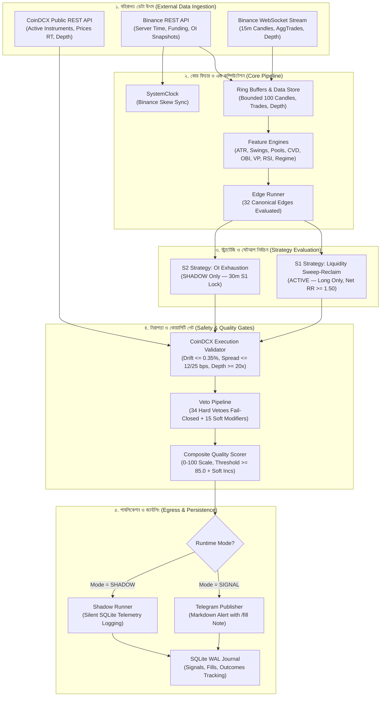

# NEO-WILDER V4 — সিস্টেম আর্কিটেকচার ও ডেটা ফ্লো গাইড (বাংলা)
## System Architecture & Data Pipeline Guide

---

## ১. ভূমিকা ও প্রধান নকশা নীতি (Introduction & Core Design Principles)

**NEO-WILDER V4** হলো একটি প্রাতিষ্ঠানিক মানের (institutional-grade), সম্পূর্ণ **SIGNAL_ONLY** ক্রিপ্টো ফিউচার্স ইন্টেলিজেন্স ইঞ্জিন। এই সিস্টেমের মূল লক্ষ্য হলো বায়ন্যান্স (Binance USD-M Futures) এর পাবলিক মার্কেট ডেটা বিশ্লেষণ করে উচ্চ-সম্ভাবনাময় (high-probability) ট্রেডিং সেটআপ চিহ্নিত করা এবং ভারতীয় ট্রেডারদের জন্য CoinDCX এক্সচেঞ্জে ম্যানুয়াল এক্সিকিউশনের উপযোগী সুনির্দিষ্ট সিগন্যাল টেলিগ্রামের মাধ্যমে পৌঁছে দেওয়া।

### মূল স্থাপত্য নীতিসমূহ (Core Architectural Invariants):
1. **স্থায়ীভাবে শুধুমাত্র সিগন্যাল (Permanently SIGNAL_ONLY):**
   সিস্টেমের কোনো অংশে স্বয়ংক্রিয় অর্ডার এক্সিকিউশন (Automated Order Execution), ব্যালেন্স প্রত্যাহার (Withdrawal) বা ট্রেডিং অ্যাকাউন্ট নিয়ন্ত্রণের কোনো কোড নেই এবং কখনোই যুক্ত করা হবে না। ট্রেড করার চূড়ান্ত সিদ্ধান্ত এবং এক্সিকিউশন সর্বদা মানব অপারেটরের (Human Operator) নিয়ন্ত্রণে থাকে।
2. **একক অ্যাসিঙ্ক্রোনাস প্রসেস (Single Asyncio Process):**
   কোনো ভারী মাল্টি-প্রসেসিং, ডকার কন্টেইনার বা মাইক্রোসার্ভিস ক্লাস্টার নয়। সম্পূর্ণ সিস্টেমটি পাইথনের `asyncio` ইভেন্ট লুপের অধীনে একক প্রসেসে চলে।
3. **সীমিত মেমরি বাজেট (Strict 1 GB RAM VPS Budget):**
   ওরাকল ক্লাউড ফ্রি-টিয়ার VPS (প্রায় ৯৫৬ মেগাবাইট র‍্যাম, ২ ভিকোর, ২ জিবি সোয়াপ) এর জন্য অপ্টিমাইজড। টার্গেট মেমরি ব্যবহার (RSS) $\le$ ২২০ মেগাবাইট, হার্ড সিলিং ৩০০ মেগাবাইট, এবং systemd ওওএম (OOM) লিমিট ৪০০ মেগাবাইট।
4. **ব্যর্থতায় সুরক্ষিত নীতি (Fail-Closed Architecture):**
   যদি ডেটা সংযোগ বিচ্ছিন্ন হয়, ক্লক ডিসিঙ্ক হয়, স্প্রেড বৃদ্ধি পায়, লিকুইডিটি কমে যায় অথবা সিস্টেম কোনো সন্দেহজনক অসঙ্গতি পায়—সিস্টেম তাৎক্ষণিকভাবে "ABSTAIN" করে এবং কোনো ভুল সিগন্যাল পাঠানো বন্ধ রাখে।
5. **একক রাইটার ডাটাবেস (SQLite WAL Single Writer):**
   কনকারেন্সি সমস্যা এড়াতে এবং দ্রুতগতির জন্য SQLite WAL (Write-Ahead Logging) মোডে চলে, যেখানে ব্যাকগ্রাউন্ড ডেটা স্টোর একক থ্রেডে নিরাপদ রাইট অপারেশন পরিচালনা করে।

---

## ২. সিস্টেমের উচ্চ-স্তরের আর্কিটেকচার ডায়াগ্রাম (High-Level Architecture Diagram)

নিচের মারমেইড (Mermaid) ডায়াগ্রামে সম্পূর্ণ সিস্টেমের ডেটা ইনজেশন থেকে শুরু করে টেলিগ্রাম পাবলিকেশন পর্যন্ত প্রতিটি ধাপ দেখানো হয়েছে:

---

## ৩. পাইপলাইনের ধাপসমূহ ও ডেটা প্রবাহ (End-to-End Pipeline Steps)

NEO-WILDER V4-এর সিগন্যাল তৈরি ও প্রক্রিয়াকরণ নিচের সুনির্দিষ্ট ক্রমানুসারে কাজ করে:

### ধাপ ১: টাইম সিনক্রোনাইজেশন (Clock Synchronization)
- **উৎস ফাইল:** `src/neo_wilder/clock.py`
- সিস্টেম প্রতিবার স্টার্ট হওয়ার সময় এবং নিয়মিত বিরতিতে বায়ন্যান্স সার্ভার টাইমের সাথে স্থানীয় ঘড়ির তুলনা করে।
- যদি টাইমের পার্থক্য (Skew) $\pm ১০০০$ মিলিমিটার বা ১ সেকেন্ডের বেশি হয়, তবে **V-H07 (CLOCK_DESYNC)** সক্রিয় হয় এবং ট্রেড বন্ধ থাকে।

### ধাপ ২: মার্কেট ডেটা রিসিভ ও মেমরি বাফারিং (Market Data & Ring Buffers)
- **উৎস ফাইল:** `src/neo_wilder/data/ws_binance.py`, `src/neo_wilder/data/store.py`
- বায়ন্যান্স ওয়েবসকেট থেকে ৮টি প্রধান পেয়ারের (BTCUSDT, ETHUSDT, SOLUSDT ইত্যাদি) জন্য ১৫-মিনিটের ক্যান্ডেল, ট্রেড এবং অর্ডারবুক ডেটা গ্রহণ করা হয়।
- প্রতিটি পেয়ারের জন্য মেমরিতে নির্দিষ্ট সাইজের (সর্বোচ্চ ১০০ ক্যান্ডেল, সীমিত ট্রেড) রিং বাফার সংরক্ষিত থাকে যাতে মেমরি লিক না ঘটে।

### ধাপ ৩: ফিচার ইঞ্জিন গণনা (Feature Calculations)
- **উৎস ফাইল:** `src/neo_wilder/features/`
- ক্যান্ডেল ক্লোজ হওয়ার সাথে সাথে নিচের সূচকগুলো গণনা করা হয়:
  - **ATR:** অস্থিরতা এবং স্টপ লস মাপার জন্য (`atr.py`)
  - **Swings & Liquidity Pools:** সুইং হাই/লো এবং ইকুয়াল হাই/লো ডিটেকশন (`swings.py`, `liquidity.py`)
  - **CVD & OBI:** কিউমুলেটিভ ভলিউম ডেল্টা এবং অর্ডারবুক ভারসাম্য (`cvd.py`, `obi.py`)
  - **Volume Profile:** ভ্যালু এরিয়া হাই/লো (VAH/VAL) এবং পয়েন্ট অব কন্ট্রোল (POC) (`volume_profile.py`)
  - **Regime:** বাজারের চরিত্র বিশ্লেষণ—ট্রেন্ডিং বনাম সাইডওয়ে (`regime.py`)

### ধাপ ৪: এজ রানার (Edge Runner Evaluation)
- **উৎস ফাইল:** `src/neo_wilder/edges/runner.py`
- ৩২টি রেজিস্টার্ড এজের বর্তমান অবস্থা পরীক্ষা করা হয়। প্রতিটি এজ নির্দিষ্ট যুক্তি অনুযায়ী পাস/ফেল এবং কনফিডেন্স স্কোর আউটপুট দেয়।

### ধাপ ৫: স্ট্র্যাটেজি ইভ্যালুয়েশন (Strategy Evaluation)
- **উৎস ফাইল:** `src/neo_wilder/strategies/s1_sweep_reclaim.py`, `src/neo_wilder/strategies/s2_oi_exhaustion.py`
- **S1 (Active):** লিকুইডিটি পুলে ফেক ব্রেকআউট (Sweep) ঘটার পর পুনরায় রেঞ্জে প্রবেশ (Reclaim) করলে একটি ক্যান্ডিডেট সেটআপ তৈরি করে। নেট R:R অবশ্যই $\ge ১.৫০$ হতে হবে।
- **S2 (Shadow):** ওপেন ইন্টারেস্ট চরম বৃদ্ধি এবং প্রাইস রিভার্সাল ঘটলে শ্যাডো ক্যান্ডিডেট তৈরি করে (শুধুমাত্র শ্যাডো মোডে)।

### ধাপ ৬: CoinDCX এক্সিকিউশন ভ্যালিডেশন (CoinDCX Gate)
- **উৎস ফাইল:** `src/neo_wilder/coindcx/validator.py`, `src/neo_wilder/data/rest_coindcx.py`
- ক্যান্ডিডেট তৈরি হওয়ার পর CoinDCX-এর রিয়েল-টাইম পাবলিক প্রাইস, স্প্রেড এবং টপ-১০ ডেপথ যাচাই করা হয়:
  - বায়ন্যান্স ও CoinDCX-এর মূল্যের পার্থক্য $\le ০.৩৫\%$ (V-H32)।
  - স্প্রেড মেজর পেয়ারে $\le ১২$ বেসিস পয়েন্ট, অল্টকয়েনে $\le ২৫$ বেসিস পয়েন্ট (V-H12)।
  - অর্ডারবুকের লিকুইডিটি কাঙ্ক্ষিত ক্লিপ সাইজের অন্তত ২০ গুণ (V-H13)।
- কোনো শর্ত ভঙ্গ হলে ক্যান্ডিডেট তৎক্ষণাৎ ড্রপ হয়।

### ধাপ ৭: ভেটো পাইপলাইন (Veto Pipeline Gate)
- **উৎস ফাইল:** `src/neo_wilder/vetoes/pipeline.py`
- ৩৪টি হার্ড ভেটোর যেকোনো একটি ট্রিগার হলে সিগন্যাল বাতিল হয়ে যায়।
- ১৫টি সফট ভেটো সক্রিয় থাকলে স্কোরিং পেনাল্টি বা থ্রেশহোল্ড বৃদ্ধি করা হয়।

### ধাপ ৮: কম্পোজিট স্কোরিং (Quality Scoring)
- **উৎস ফাইল:** `src/neo_wilder/scoring/groups.py`
- ৬টি অর্থোগোনাল ক্লাস্টারের ভিত্তিতে ক্যান্ডিডেটকে ০ থেকে ১০০ স্কেলে স্কোর দেওয়া হয়।
- মোট স্কোর যদি কার্যকরী থ্রেশহোল্ড (বেস ৮৫.০ + সফট ভেটো বৃদ্ধি) এর কম হয়, তবে সিগন্যাল ব্লক হয়।

### ধাপ ৯: মোড ডিসপ্যাচ ও টেলিগ্রাম পাবলিকেশন (Egress & Telegram Alert)
- **উৎস ফাইল:** `src/neo_wilder/publish/telegram.py`, `src/neo_wilder/main.py`
- **SIGNAL মোড:** অনুমোদিত সিগন্যালটি ফরম্যাট করে টেলিগ্রাম বট API-এর মাধ্যমে চ্যানেলে পাঠানো হয় এবং ডাটাবেস জার্নালে সেভ করা হয়।
- **SHADOW মোড:** টেলিগ্রামে কোনো বার্তা যায় না; নীরবে SQLite ডাটাবেসে টেলিমেট্রি রেকর্ড করা হয়।

---

## ৪. রিসোর্স ব্যবস্থাপনা ও ব্যর্থতা পুনরুদ্ধার (Resource Safety & Watchdog)

1. **প্রসেস ওয়াচডগ (Process Watchdog):**
   - প্রতি ১৫ সেকেন্ড পরপর ইন্টারনাল হার্টবিট চেক করা হয়।
   - পর্যায়ক্রমিক ৩টি হার্টবিট মিস হলে প্রসেস ডিগ্রেডেড ল্যাডারের মাধ্যমে অটোমেটিক জরুরি স্টপ (Emergency Halt) ঘোষণা করে (V-H10)।
2. **মেমরি মনিটরিং (RSS Ceiling):**
   - প্রতি ১০ সেকেন্ড অন্তর `psutil` দিয়ে প্রসেসের মেমরি ব্যবহার মাপা হয়।
   - মেমরি ৩০০ মেগাবাইট অতিক্রম করলে বা ফ্রি মেমরি ১২০ মেগাবাইটের নিচে নামলে **V-H08** কার্যকর হয়ে নতুন সিগন্যাল উৎপাদন স্থগিত করে।
3. **ওরাকল ক্লাউড systemd অটো-রিস্টার্ট:**
   - কোনো অনাকাঙ্ক্ষিত ক্র্যাশ হলে systemd ১০ সেকেন্ডের মধ্যে পুনরায় সার্ভিসটি চালু করে এবং ডাটাবেসের WAL চেকপয়েন্ট থেকে আগের ট্র্যাক করা সিগন্যাল রিলোড করে।
