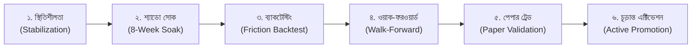

# NEO-WILDER V4 — শ্যাডো রোডম্যাপ ও ভবিষ্যৎ উন্নয়ন গাইড (বাংলা)
## Shadow Soak Framework & Strategy Promotion Roadmap

---

## ১. ভূমিকা (Introduction)

পরিমাণগত বা কোয়ান্ট ট্রেডিংয়ে (Quantitative Trading) কোনো নতুন আইডিয়া বা স্ট্র্যাটেজি কখনোই সরাসরি আসল বাজারে চালু করা উচিত নয়। ব্যাকটেস্টের ফলাফল চমৎকার দেখালেও রিয়েল-টাইম বাজারে স্লিপেজ, স্প্রেড, লিকুইডিটি এবং এক্সিকিউশন ডিলের কারণে সেই ফলাফল ব্যর্থ হতে পারে।

**NEO-WILDER V4** একটি কঠোর **শ্যাডো সোক (Shadow Soak)** ফ্রেমওয়ার্ক অনুসরণ করে, যেখানে যেকোনো নতুন এজ বা স্ট্র্যাটেজিকে কমপক্ষে **৮ সপ্তাহ লাইভ মার্কেটে নীরবে (Shadow Mode)** পর্যবেক্ষণ করতে হয়।

---

## ২. বর্তমান সক্রিয় বনাম শ্যাডো বনাম ভবিষ্যৎ উপাদানসমূহ (Component Comparison)

| উপাদান (Component) | বর্তমানে সক্রিয় (ACTIVE) | শ্যাডো মোডে চলমান (SHADOW) | ভবিষ্যৎ প্রস্তাবিত (PLANNED) |
|---|---|---|---|
| **ট্রেডিং স্ট্র্যাটেজি** | `S1_SWEEP_RECLAIM` (LONG) | `S2_OI_EXHAUSTION` (LONG) | S4 (Trend), S5 (Cascade), S6 (Squeeze), S7 (Band) |
| **কোর এজসমূহ** | E01, E03, E04, E07, E11, E12, E23, E24, E28, X01..04 | E02, E05, E06, E10, E13, E15, E16, E17, E20, E21, E25 | E08, E09, E14, E22, E27 (পরীক্ষামূলক থেকে উত্তরণ) |
| **টেলিগ্রাম এলার্ট** | অনুমোদিত সিগন্যাল পাবলিশ হয় | শূন্য নির্গমন (Zero Telegram Egress) | — |
| **ডাটাবেস সংরক্ষণ** | লাইভ জার্নাল ও ট্র্যাকিং | সাইলেন্ট টেলিমেট্রি লগ | বিস্তারিত পারফরম্যান্স ড্যাশবোর্ড |

---

## ৩. শ্যাডো থেকে অ্যাক্টিভ মোডে উত্তরণের ৬টি পর্যায় (6-Phase Promotion Lifecycle)

যেকোনো নতুন স্ট্র্যাটেজিকে সক্রিয় করতে নিচের ৬টি পর্যায় অতিক্রম করা বাধ্যতামূলক:

### পর্যায় ১: বিদ্যমান সিস্টেম স্থিতিশীলকরণ (Stabilization)
- বর্তমান S1 স্ট্র্যাটেজি ও কোরে কোনো বাগ না থাকা এবং মেমরি ব্যবহার $\le ২২০$ MB বজায় থাকা।

### পর্যায় ২: ৮ সপ্তাহের শ্যাডো সোক (Shadow Candidate Evaluation)
- লাইভ মার্কেটে কোনো টেলিগ্রাম নোটিফিকেশন না পাঠিয়ে ডাটাবেসে নীরবে ক্যান্ডিডেট রেকর্ড করা।
- বাজার পরিস্থিতির সাথে ক্যান্ডিডেটদের বাস্তবসম্মত আউটকাম (Win Rate, Drawdown) সংগ্রহ।

### পর্যায় ৩: ঘর্ষণ-সচেতন ব্যাকটেস্টিং (Rigorous Backtesting)
- CoinDCX-এর ০.১৩৫৪% রাউন্ড-ট্রিপ ফি, স্প্রেড ও স্লিপেজ অন্তর্ভুক্ত করে হিস্টোরিক্যাল ব্যাকটেস্ট।

### পর্যায় ৪: ওয়াক-ফরওয়ার্ড ভ্যালিডেশন (Walk-Forward Validation)
- আউট-অব-স্যাম্পল (Out-of-sample) ডেটাতে প্যারামিটার ওভারফিটিং পরীক্ষা।
- একাধিক ভিন্ন ভিন্ন উইন্ডোতে শার্প রেশিও $\ge ১.২০$ থাকা আবশ্যক।

### পর্যায় ৫: পেপার ট্রেডিং ভ্যালিডেশন (Paper Validation)
- রিয়েল-টাইম লাইভ ক্যান্ডেলে কাল্পনিক এক্সিকিউশন ও স্লিপেজ অডিট।

### পর্যায় ৬: সুনির্দিষ্ট অনুমোদন ও এক্টিভেশন (Careful Activation)
- সকল কোয়ালিটি গেট ও সুরক্ষা অডিটের পর শুধুমাত্র দীর্ঘমেয়াদে প্রমাণিত হলে তবেই সক্রিয় কোডে রূপান্তর।

---

## ৪. পরিমাপযোগ্য পদোন্নতির মাপকাঠি (Measurable Promotion Criteria)

একটি শ্যাডো স্ট্র্যাটেজি তখনই সক্রিয় হতে পারে যদি এটি নিচের সমস্ত মানদণ্ড পূরণ করে:
1. **ন্যূনতম স্যাম্পল সাইজ:** কমপক্ষে ১০০টি স্বাধীন শ্যাডো ট্রেডের ডেটা সংরক্ষিত হতে হবে।
2. **নেট এক্সপেক্ট্যান্সি (Positive Net EV):** সকল ফি ও স্লিপেজের পর প্রতি ট্রেডে গড় রিটার্ন $\ge +০.১৫R$ হতে হবে।
3. **প্রফিট ফ্যাক্টর (Profit Factor):** ন্যূনতম ১.৫০।
4. **সর্বোচ্চ ড্রডাউন (Max Drawdown):** মূলধনের ১২%-এর কম হতে হবে।
5. **অর্থোগোনালিটি (Orthogonality):** বিদ্যমান S1 স্ট্র্যাটেজির সাথে সিগন্যাল ডুপ্লিকেশন বা পারস্পরিক বিরোধিতা ৩০%-এর কম হতে হবে।
