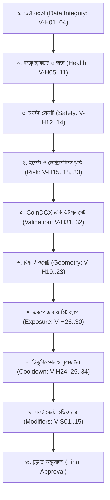

# NEO-WILDER V4 — ভেটো ইনভেন্টরি ও নিরাপত্তা ফ্রেমওয়ার্ক (বাংলা)
## Complete 49 Veto Inventory & Fail-Closed Governance

---

## ১. ভূমিকা ও ভেটো ফিলোসফি (Philosophy & Overview)

**NEO-WILDER V4**-এর মূল দর্শন হলো: *"সুযোগ হারানোর চেয়ে মূলধন রক্ষা করা কোটি গুণ বেশি গুরুত্বপূর্ণ।"* বাজারে প্রতিদিন শত শত মিথ্যা বা বিপজ্জনক সিগন্যাল তৈরি হয়। এই ইঞ্জিনটি এমনভাবে ডিজাইন করা হয়েছে যাতে সন্দেহজনক যেকোনো পরিস্থিতিতে সিস্টেম তাৎক্ষণিকভাবে **Fail-Closed (নিরাপদে প্রত্যাখ্যান)** পদ্ধতিতে ট্রেড বাতিল করে।

সিস্টেম রেজিস্ট্রিতে (`config/veto_registry.yaml`) সর্বমোট **৪৯টি ক্যানোনিকাল ভেটো** নিবন্ধিত রয়েছে:
- **হার্ড ভেটো (Hard Vetoes):** ৩৪টি (`V-H01` থেকে `V-H34`) — অলঙ্ঘনীয় বাধা। এর যেকোনো একটি সক্রিয় হলে সিগন্যাল অবিলম্বে বাতিল হয়।
- **সফট ভেটো (Soft Vetoes):** ১৫টি (`V-S01` থেকে `V-S15`) — কোয়ালিটি পেনাল্টি। এগুলো স্কোর কমিয়ে দেয় অথবা অনুমোদনের থ্রেশহোল্ড বৃদ্ধি করে।

> [!CAUTION]
> **OVERRIDE POLICY DEFAULT:**
> কোনো হার্ড ভেটো কখনোই কোনো স্কোর, উইন-রেট প্রোবাবিলিটি, অপারেটর ফ্ল্যাগ বা কনফিগারেশন ভ্যারিয়েবল দ্বারা বাইপাস (Bypass/Override) করা সম্ভব নয়।

---

## ২. ভেটো প্রক্রিয়াকরণের সুনির্দিষ্ট ক্রম (Veto Execution Order)

পাইপলাইনে ভেটোগুলো নিচের ১০টি নির্দিষ্ট স্তরে ক্রমানুসারে মূল্যায়িত হয়:

---

## ৩. সম্পূর্ণ ৩৪টি হার্ড ভেটোর বিস্তারিত তালিকা (34 Hard Vetoes Inventory)

| ভেটো আইডি | কারণ কোড (Reason Code) | তীব্রতা (Severity) | ব্লকিং শর্ত (Blocking Condition) | উদ্দেশ্য ও ভূমিকা (Purpose) |
|:---:|---|:---:|---|---|
| **V-H01** | `DATA_STALE` | CRITICAL | সর্বশেষ ক্যান্ডেল ক্লোজ $2 \times \text{TF} + 30\text{s}$ পুরানো | বিলম্বিত ডেটায় বিভ্রান্তিকর এন্ট্রি প্রতিরোধ |
| **V-H02** | `DATA_GAP` | CRITICAL | শেষ ২০টি ক্যান্ডেলের মধ্যে $\ge ১$টি ক্যান্ডেল অনুপস্থিত | ইনডিকেটর গণনার ধারাবাহিকতা নিশ্চিতকরণ |
| **V-H03** | `CANDLE_TS_INVALID` | CRITICAL | টাইমস্ট্যাম্প অমিল অথবা ক্লোজ প্রাইস $\le ০$ | বিকৃত বা করাপ্টেড ডেটা প্রতিরোধ |
| **V-H04** | `DUPLICATE_CANDLE` | CRITICAL | একই `open_time` একাধিকবার প্রসেস হওয়া | ডবল সিগন্যাল ফায়ারিং বন্ধ করা |
| **V-H05** | `WS_DISCONNECTED` | CRITICAL | বায়ন্যান্স ওয়েবসকেট ৫ সেকেন্ডের বেশি সংযোগহীন | রিয়েল-টাইম সংযোগহীনতায় অন্ধ ট্রেডিং রোধ |
| **V-H06** | `ORDERBOOK_STALE` | HIGH | অর্ডারবুকের বয়স ৩ সেকেন্ডের বেশি পুরানো | বাসি ডেপথ দেখে স্লিপেজ ভুল অনুমান রোধ |
| **V-H07** | `CLOCK_DESYNC` | HIGH | লোকাল ও সার্ভার টাইমের পার্থক্য $> ১০০০$ মিলিমিটার | টাইমস্ট্যাম্প মিল না থাকলে অর্ডার ভ্যালিডেশন ব্যর্থ |
| **V-H08** | `MEMORY_EMERGENCY` | CRITICAL | প্রসেস RSS $> ৩০০$ মেগাবাইট বা ফ্রি র‍্যাম $< ১২০$ মেগাবাইট | VPS ওওএম (Out of Memory) ক্র্যাশ প্রতিরোধ |
| **V-H09** | `KILL_SWITCH` | CRITICAL | অপারেটর কর্তৃক ইমার্জেন্সি ফ্ল্যাগ সক্রিয় | ম্যানুয়াল জরুরি শাটডাউন কার্যকর করা |
| **V-H10** | `WATCHDOG_FAILURE` | CRITICAL | প্রসেস ওয়াচডগ টানা ৩টি ইন্টারভাল মিস করেছে | ইন্টারনাল ইভেন্ট লুপ ফ্রিজ শনাক্তকরণ |
| **V-H11** | `CRITICAL_SOURCE_DOWN`| HIGH | ফান্ডিং বা ওপেন ইন্টারেস্ট ১০ মিনিট অনুপলব্ধ | অন্ধ ডেরিভেটিভস রিস্কে ট্রেড না করা |
| **V-H12** | `ABNORMAL_SPREAD` | HIGH | স্প্রেড $> ১২$ bps (Major) বা $> ২৫$ bps (Alt) | অতিরিক্ত স্প্রেড কস্টে প্রফিট ধ্বংস রোধ |
| **V-H13** | `INSUFFICIENT_LIQUIDITY`| HIGH| টপ-১০ ডেপথ $< ২০ \times$ ক্লিপ সাইজ | অগভীর লিকুইডিটিতে বড় স্লিপেজ প্রতিরোধ |
| **V-H14** | `EXTREME_GAP` | HIGH | বারের গ্যাপ ওপেন $> ৩\%$ | অস্বাভাবিক ফ্ল্যাশ ক্র্যাশ বা ইললিকুইড গ্যাপ |
| **V-H15** | `NEWS_WINDOW_ACTIVE` | HIGH | হাই-ইম্প্যাক্ট নিউজ ইভেন্টের $\pm ১৫/৩০$ মিনিট | সংবাদজনিত ওয়াইল্ড স্লিপেজ এড়ানো |
| **V-H16** | `NEWS_DATA_UNAVAILABLE`| HIGH| ইভেন্ট ক্যালেন্ডার ফিড ডাউন (Fail Closed) | নিউজ সুরক্ষা অন্ধ থাকলে ট্রেড না করা |
| **V-H17** | `FUNDING_WINDOW_ACTIVE`| MEDIUM| ৮-ঘণ্টা ফান্ডিং সেটেলমেন্টের $-১৫/+৫$ মিনিট | ফান্ডিং ফি ওঠানামার ভোলাটিলিটি এড়ানো |
| **V-H18** | `MARK_INDEX_DIVERGENCE`| HIGH | মার্ক ও ইনডেক্স মূল্যের বিচ্যুতি $> ০.৫০\%$ | স্পট-পার্প চরম ডিসলোকেশন বা ম্যানিপুলেশন |
| **V-H19** | `ENTRY_GEOMETRY_INVALID`| CRITICAL| ইনভার্টেড জোন বা এন্ট্রি জোন $> 0.5 \times \text{ATR}$ | ভুল ট্রেড জ্যামিতি ফিল্টার |
| **V-H20** | `STOP_INVALID` | CRITICAL | SL $< \max(0.65\%, 0.5\text{ATR})$ বা $> 4.5\text{ATR}$ | অযৌক্তিক সংকীর্ণ বা চরম দূরবর্তী স্টপ |
| **V-H21** | `TARGET_INVALID` | CRITICAL | টার্গেট ক্রমানুসারে ভুল বা এন্ট্রি জোনের ভেতর | ভুল লাভ লক্ষ্যমাত্রা প্রতিরোধ |
| **V-H22** | `NET_RR_TOO_LOW` | CRITICAL | ফি ও ঘর্ষণের পর নেট R:R $< ১.৫০$ | নেতিবাচক প্রত্যাশিত মান (Negative EV) বাতিল |
| **V-H23** | `SLIPPAGE_TOO_HIGH` | HIGH | আনুমানিক স্লিপেজ স্টপ দূরত্বের $> ১৫\%$ | স্লিপেজে রিস্ক বাজেটের সীমা লঙ্ঘন রোধ |
| **V-H24** | `DUPLICATE_SIGNAL` | MEDIUM | একই পেয়ার ও ডিরেকশনে ৩০ মিনিটের মধ্যে পুনরায় সিগন্যাল | ওভার-ট্রেডিং ও বারবার এলার্ট বন্ধ |
| **V-H25** | `SYMBOL_COOLDOWN` | MEDIUM | সিম্বলটি ৩০ মিনিটের লকের মধ্যে রয়েছে | একই পেয়ারে দ্রুত পুনঃপ্রবেশ আটকানো |
| **V-H26** | `PORTFOLIO_HEAT` | HIGH | চলমান ট্রেড $\ge ২$ অথবা মোট রিস্ক $> ৩\%$ | অ্যাকাউন্ট ওভার-লিভারেজড হওয়া রোধ |
| **V-H27** | `CLUSTER_HEAT` | HIGH | একই কোরিলেটেড ক্লাস্টারে রিস্ক $> ২.০R$ | কোরিলেটেড পতনে বড় ড্রডাউন রোধ |
| **V-H28** | `DAILY_LOSS_CAP` | CRITICAL | দৈনিক ড্রডাউন $\le -৩\%$ স্পর্শ করা | একদিনে পুঁজির অপূরণীয় ক্ষতি আটকানো |
| **V-H29** | `WEEKLY_LOSS_CAP` | CRITICAL | সাপ্তাহিক ড্রডাউন $\le -৬\%$ স্পর্শ করা | সপ্তাহজুড়ে ধারাবাহিক ক্ষতি বন্ধ করা |
| **V-H30** | `TRADING_HALTED` | CRITICAL | এক্সচেঞ্জে সিম্বলের স্ট্যাটাস `TRADING` নয় | ট্রেডিং স্থগিত থাকা অবস্থায় সিগন্যাল রোধ |
| **V-H31** | `COINDCX_FEED_UNAVAILABLE`| HIGH| পাবলিকেশনের সময় CoinDCX কোটেশন অনুপস্থিত | অজানা মূল্যে অন্ধ সিগন্যাল পাঠানো নিষেধ |
| **V-H32** | `ENTRY_DRIFT_EXCEEDED`| HIGH | বায়ন্যান্স ও CoinDCX মূল্যের বিচ্যুতি $> ০.৩৫\%$ | ভারতের স্থানীয় মূল্যের সাথে বড় ব্যবধান রোধ |
| **V-H33** | `REGIME_INELIGIBLE` | MEDIUM | মার্কেট `NOISE_CHOP` বা ATR সীমা বহির্ভূত | দিকহীন এলোমেলো বাজারে সিগন্যাল বন্ধ |
| **V-H34** | `MODEL_PROBABILITY_UNVALIDATED`| CRITICAL| ক্যালিব্রেশন ফাইল অনুপস্থিত বা $> ৯০$ দিন পুরানো | মেয়াদোত্তীর্ণ বা অপ্রমাণিত মডেলে ট্রেড রোধ |

---

## ৪. সম্পূর্ণ ১৫টি সফট ভেটোর তালিকা (15 Soft Vetoes & Penalties)

| ভেটো আইডি | কারণ কোড (Reason Code) | পেনাল্টি বা প্রভাব (Penalty / Effect) | হার্ড ভেটোতে রূপান্তরের শর্ত (Escalation) |
|:---:|---|---|---|
| **V-S01** | `BTC_DIRECTIONAL_CONFLICT` | কনফিডেন্স $-১৫$, পাবলিশ থ্রেশহোল্ড $+৫$ | BTC ৫-মিনিটে $<-১.০\%$ ড্রপ করলে হার্ড ভেটো |
| **V-S02** | `BTC_VOLATILITY_INSTABILITY`| কনফিডেন্স $-১০$ | — |
| **V-S03** | `WEAK_TREND` | কনফিডেন্স $-৮$ (ADX14 $< ১৮$) | — |
| **V-S04** | `FUNDING_EXTREME` | পজিশন সাইজিং $\times ০.৫$ | ফান্ডিং $> |০.০৫\%|$ হলে হার্ড ভেটো |
| **V-S05** | `OI_INSTABILITY` | কনফিডেন্স $-৮$ | — |
| **V-S06** | `POOR_LIQUIDITY` | পজিশন সাইজিং $\times ০.৬$ | — |
| **V-S07** | `CORRELATED_EXPOSURE` | পজিশন সাইজিং $\times ০.৫$ | — |
| **V-S08** | `CLUSTER_HEAT_HIGH` | পাবলিশ থ্রেশহোল্ড $+৩$ | ক্লাস্টার রিস্ক $> ২.০R$ হলে হার্ড ভেটো |
| **V-S09** | `WEAK_SESSION` | কনফিডেন্স $-৫$ | — |
| **V-S10** | `LATE_ENTRY` | পাবলিশ থ্রেশহোল্ড $+৫$ | এন্ট্রি জোন প্রগ্রেস $> ৩৫\%$ হলে হার্ড ভেটো |
| **V-S11** | `WEAK_ORDERFLOW` | কনফিডেন্স $-১০$ | — |
| **V-S12** | `VOLATILITY_MISMATCH` | পজিশন সাইজিং $\times ০.৭$ | — |
| **V-S13** | `LOW_QUALITY_REGIME` | কনফিডেন্স $-১২$ | — |
| **V-S14** | `POOR_EXECUTION_QUALITY` | পাবলিশ থ্রেশহোল্ড $+৫$ | — |
| **V-S15** | `SCORE_BELOW_PUBLISH` | সিগন্যাল সাইলেন্টলি রিজেক্ট | স্কোর $< ৮৫.০$ হলে সিগন্যাল ড্রপ |
