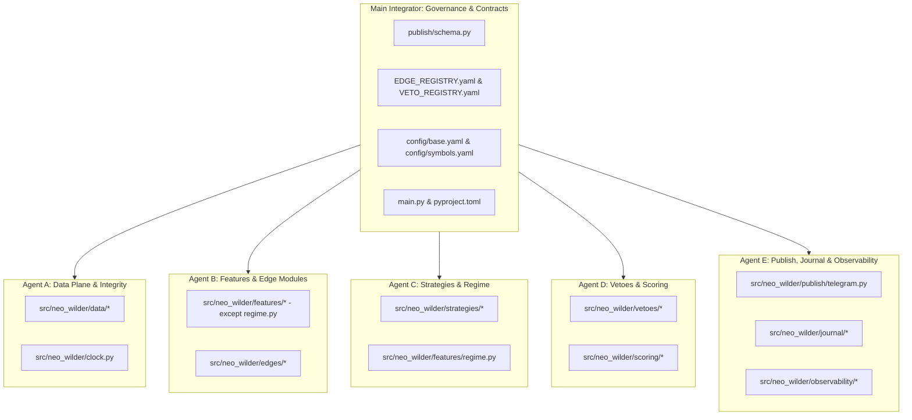

# AGENT_WORK_ASSIGNMENTS.md — NEO-WILDER V4 Parallel Agent Boundaries

**Audit Date:** 2026-11-06  
**Auditor Role:** Chief Architect & Main Integrator  
**Audit Scope:** Division of engineering responsibilities, directory ownership, locked file policies, and phased merge sequence for five parallel implementation agents.

---

## 1. Governance & Absolute Freeze Rules

> [!CAUTION]
> **PARALLEL AGENTS MUST NOT BE LAUNCHED YET:**  
> Per Phase 0 instructions, **no parallel coding agents (Agents A–E) may be started, and no application code may be written**, until the Chief Architect's Phase 0 Source Audit is reviewed and approved by the User.

### The Role of the Main Integrator (Chief Architect)
The Main Integrator maintains ultimate architectural integrity across the repository. Responsibilities:
1. Freezing all shared data contracts, interfaces, and registry definitions.
2. Reviewing and merging all pull requests from Agents A–E.
3. Conducting integration, chaos, and end-to-end replay tests across subsystem boundaries.
4. Enforcing memory budgets (<=220 MB RSS) and zero look-ahead data integrity.
5. Absolute refusal of any feature violating the permanent `SIGNAL_ONLY` contract.

---

## 2. Agent Work Allocation & Directory Boundaries

### 2.1 Agent A: Data Plane & Integrity
- **Assigned Directories & Files:**
  - `src/neo_wilder/clock.py`
  - `src/neo_wilder/data/ws_binance.py`
  - `src/neo_wilder/data/rest_binance.py`
  - `src/neo_wilder/data/rest_coindcx.py`
  - `src/neo_wilder/data/integrity.py`
  - `src/neo_wilder/data/store.py`
  - `tests/unit/data/*`, `tests/integration/data/*`
- **Deliverables:**
  - Dual WebSocket client (`aggTrade`, `kline_5m`, `depth20@100ms`, `!forceOrder@arr`).
  - Binance REST pollers for OI and funding with circuit breakers.
  - CoinDCX public REST fetchers (active instruments, current prices, depth 10/20/50).
  - Continuity, duplicate, and gap auditing engine feeding `V-H01` through `V-H04`.
  - SQLite WAL persistence manager with single-writer loop.
- **Forbidden Actions:** No private authenticated endpoints; no pandas; no unbounded queues.

### 2.2 Agent B: Feature Engine & Edge Modules
- **Assigned Directories & Files:**
  - `src/neo_wilder/features/swings.py`
  - `src/neo_wilder/features/liquidity.py`
  - `src/neo_wilder/features/structure.py`
  - `src/neo_wilder/features/zones.py`
  - `src/neo_wilder/features/volume_profile.py`
  - `src/neo_wilder/features/atr.py`
  - `src/neo_wilder/features/funding.py`
  - `src/neo_wilder/features/cvd.py`
  - `src/neo_wilder/features/obi.py`
  - `src/neo_wilder/edges/base.py`, `registry.py`, `e01_...` through `x04_...`
  - `tests/unit/features/*`, `tests/unit/edges/*`
- **Deliverables:**
  - Deterministic, pure-function feature transforms taking numpy arrays and returning typed dataclasses.
  - Registry-driven edge evaluators conforming to `evaluate(ctx) -> EdgeResult`.
  - Positive, negative, and abstain test fixtures for every edge.
- **Forbidden Actions:** No network calls; no database access; no feature reading index $> t$ (look-ahead); no score modifications for shadow edges.

### 2.3 Agent C: Strategies & Regime Engine
- **Assigned Directories & Files:**
  - `src/neo_wilder/strategies/base.py`
  - `src/neo_wilder/strategies/s1_sweep_reclaim.py`
  - `src/neo_wilder/strategies/s2_oi_exhaustion.py`
  - `src/neo_wilder/strategies/s3_basis.py`
  - `src/neo_wilder/features/regime.py`
  - `tests/unit/strategies/*`
- **Deliverables:**
  - Lo-MacKinlay Variance Ratio composite regime tracker (`vr_state`, `vol_state`, `stress_flag`).
  - Active spine S1 (`SWEEP-RECLAIM-v4`) generating symmetric LONG and SHORT candidates.
  - Shadow engine S2 (`OI-EXHAUSTION-v4`) with 30-minute S1 collision lock.
  - Experimental engine S3 (`BASIS-DIVERGENCE-v4`) with 150 ms clock-desync guard.
- **Forbidden Actions:** Cannot invent missing strategy formulas (must implement verified formulas approved in Phase 0 signoff); cannot bypass regime gating.

### 2.4 Agent D: Veto Framework & Scoring Engine
- **Assigned Directories & Files:**
  - `src/neo_wilder/vetoes/hard.py`
  - `src/neo_wilder/vetoes/soft.py`
  - `src/neo_wilder/vetoes/governor.py`
  - `src/neo_wilder/vetoes/pipeline.py`
  - `src/neo_wilder/scoring/groups.py`
  - `src/neo_wilder/scoring/calibrate.py`
  - `tests/unit/vetoes/*`, `tests/unit/scoring/*`
- **Deliverables:**
  - Fail-closed hard veto pipeline implementing all 34 hard vetoes (`V-H01`..`V-H34`).
  - Soft veto engine implementing all 15 soft vetoes (`V-S01`..`V-S15`) with escalation logic.
  - Portfolio and cluster heat governors enforcing max 2 concurrent trades and 3.0% total risk.
  - Orthogonal cluster scoring engine (C1–C6) capping C1+C2 at 24 points.
  - Isotonic probability calibration loader (mandates `"NOT CALIBRATED"` string if $<300$ trades or artefact missing).
- **Forbidden Actions:** No mechanism that allows any score, probability, or flag to override a hard veto; no double-counting of E17 across C1 and C2.

### 2.5 Agent E: Publish, Journal & Observability
- **Assigned Directories & Files:**
  - `src/neo_wilder/publish/telegram.py`
  - `src/neo_wilder/journal/signals.py`
  - `src/neo_wilder/journal/fills.py`
  - `src/neo_wilder/journal/outcomes.py`
  - `src/neo_wilder/observability/health.py`
  - `src/neo_wilder/observability/watchdog.py`
  - `src/neo_wilder/observability/metrics.py`
  - `src/neo_wilder/observability/logging.py`
  - `tests/unit/publish/*`, `tests/unit/journal/*`, `tests/unit/observability/*`
- **Deliverables:**
  - Telegram alert formatter rendering bilingual Bengali/English thesis, execution parameters, and CoinDCX verification metrics.
  - Complete journal subsystem tracking signals, manual `/fill` commands, and resolved trade outcomes.
  - Observability stack monitoring RSS (triggering `V-H08` at 300 MB) and event loop delay (triggering watchdog kill switch `V-H10`).
- **Forbidden Actions:** No order execution logic; no `/200` score formatting; cannot silently drop unfilled signals in journal accounting.

---

## 3. Strictly Locked Files (No Parallel Agent May Modify)

The following files are **frozen by the Main Integrator**. Any unauthorized edit by Agents A–E will cause immediate PR rejection:

1. `EDGE_REGISTRY.yaml`
2. `VETO_REGISTRY.yaml`
3. `config/base.yaml`
4. `config/symbols.yaml`
5. `src/neo_wilder/publish/schema.py`
6. `docs/source/*`
7. `docs/audit/*`

---

## 4. Phased Integration & Merge Sequence

To prevent merge conflicts and verify contracts progressively, implementation proceeds in strict sequential gates:

| Step | Gate Name | Agents Involved | Integration Pre-requisite | Pass Criteria |
|---|---|---|---|---|
| **Gate 1** | Schema & Registries Frozen | Main Integrator | Phase 0 Signoff | YAML lint passes; schema frozen |
| **Gate 2** | Data Plane & Store | Agent A | Gate 1 | 6-hour soak test passes; RSS < 120 MB |
| **Gate 3** | Feature Transforms | Agent B | Gate 2 | Look-ahead shuffle test passes; 1e-9 parity |
| **Gate 4** | Pure Edge Modules | Agent B | Gate 3 | Pos/neg/abstain fixtures pass for all edges |
| **Gate 5** | Strategies & Regime | Agent C | Gate 4 | S1 emits on historical replay (0.5–6/day) |
| **Gate 6** | Vetoes & Scoring | Agent D | Gate 5 | 34 hard veto tests pass; score 100 blocks |
| **Gate 7** | Publishing & Journal | Agent E | Gate 6 | Telegram snapshot match; `/fill` recorded |
| **Gate 8** | Monolith Integration | Main Integrator + All | Gate 7 | End-to-end replay passes without error |
